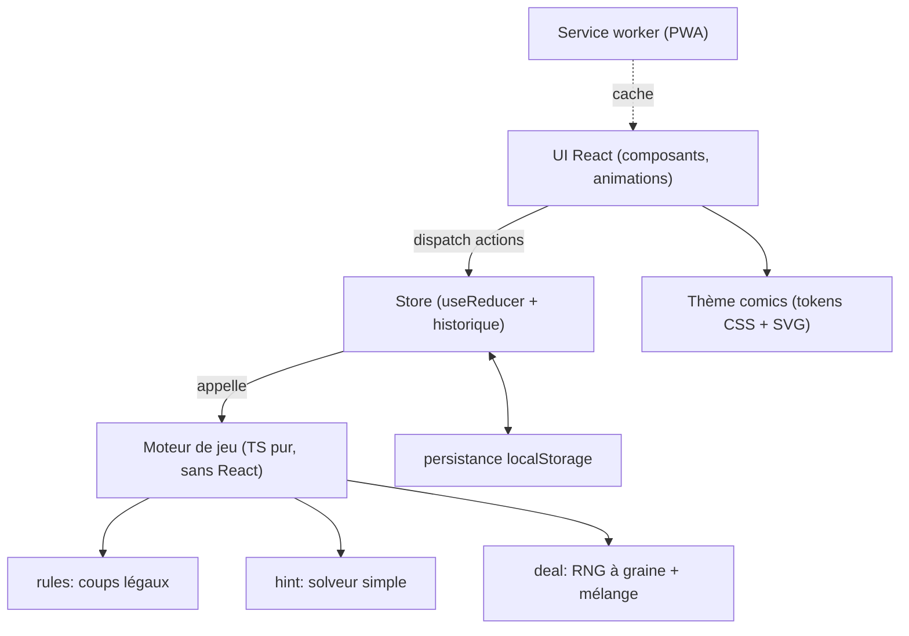

# Architecture

Stack : React + Vite + TypeScript, Framer Motion, vite-plugin-pwa, Vitest. Hébergement GitHub Pages.



**Principe clé** : le moteur ne connaît ni React ni le DOM. C'est `état + action -> nouvel état`, entièrement testable. L'annulation = pile d'états précédents (immuables, aucune logique inverse à écrire).

## Structure de dossiers
```
src/
  engine/      types.ts, deal.ts, rules.ts, moves.ts, hint.ts, autocomplete.ts, *.test.ts
  state/       reducer.ts, history.ts, persistence.ts, settings.ts
  ui/          Board, Card, Pile, Stock, Waste, Foundations, Toolbar, WinOverlay, UpdatePrompt
  ui/input/    useDrag.ts, useTapMove.ts
  theme/       tokens.css, comics.css, card-svg/
docs/          SPECS.md, ARCHITECTURE.md, BACKLOG.md, DECISIONS.md
```

## Modèle de données (esquisse)
```ts
type Suit = 'S' | 'H' | 'D' | 'C'
type Card = { id: string; suit: Suit; rank: 1..13; faceUp: boolean }
type GameState = {
  tableau: Card[][]; foundations: Card[][]; stock: Card[]; waste: Card[]
  drawCount: 1 | 3; moves: number; elapsedMs: number; seed: string
  status: 'playing' | 'won'
}
type Action =
  | { type: 'DRAW' }
  | { type: 'MOVE'; from: PileRef; to: PileRef; count: number }
  | { type: 'UNDO' }
  | { type: 'NEW_GAME'; drawCount: 1 | 3; seed?: string }
  | { type: 'AUTOCOMPLETE_STEP' }
```
Ce modèle sera affiné au jalon 1.

## Chaîne de build et déploiement
- `vite.config.ts` : `base` pilotée par `BASE_PATH` (défaut `/solitaire/`), PWA en mode `registerType: 'prompt'`.
- Push sur `main` → GitHub Actions : lint, tests, build → GitHub Pages.
- Icônes PWA générées depuis `public/favicon.svg` (`npm run icons`).
- TypeScript `strict` + `noUncheckedIndexedAccess`.
